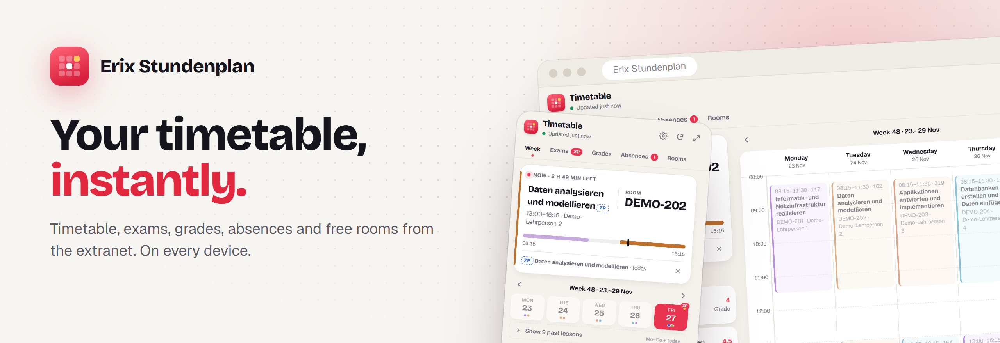
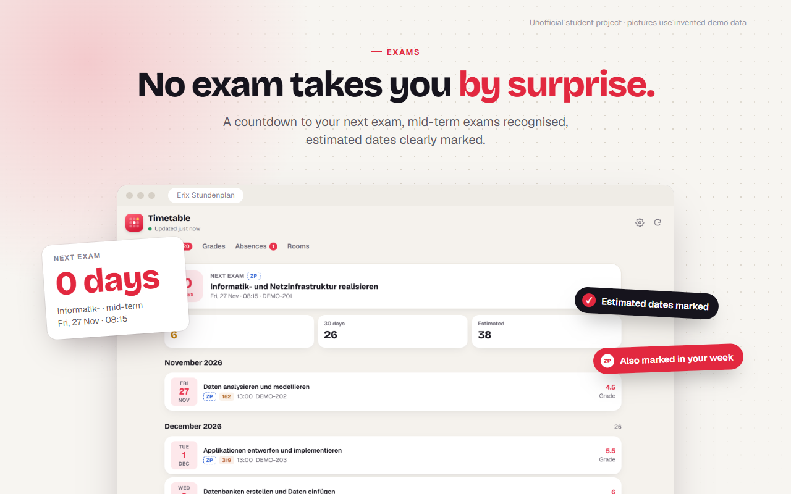
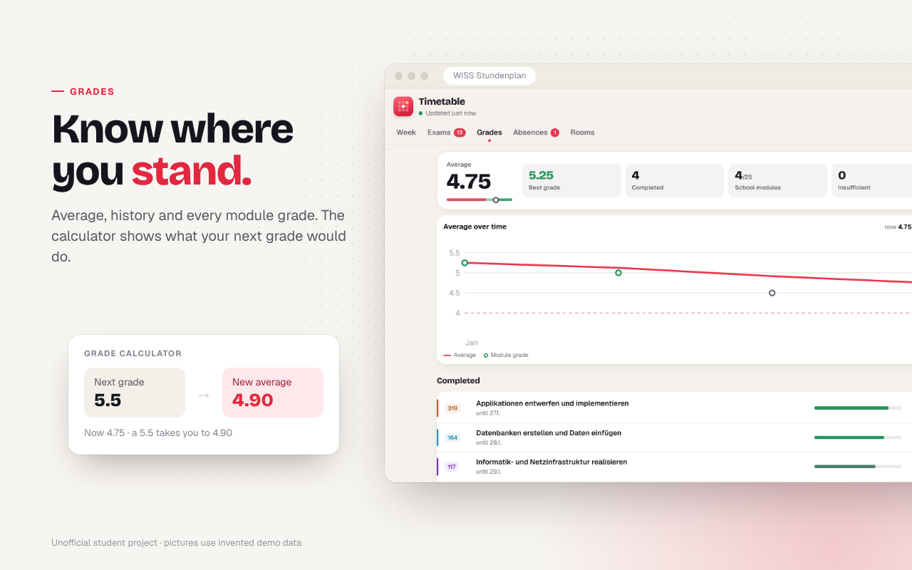
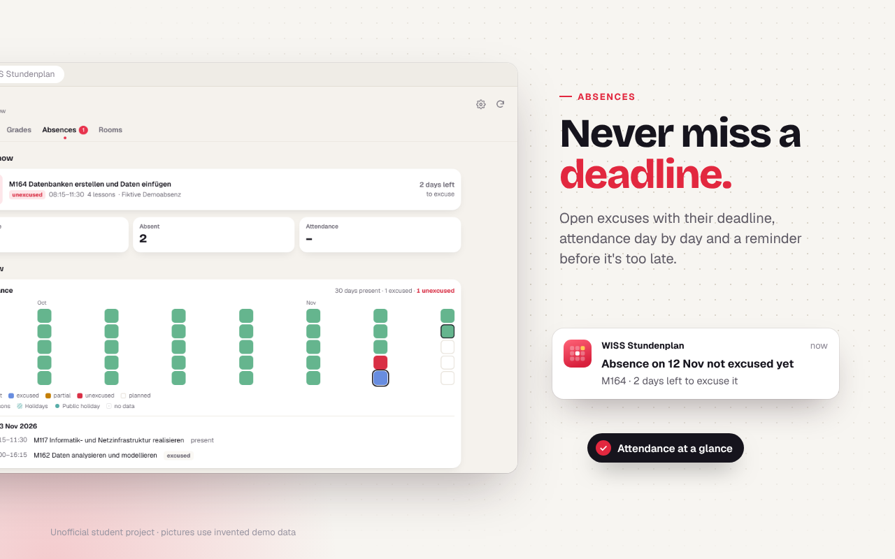
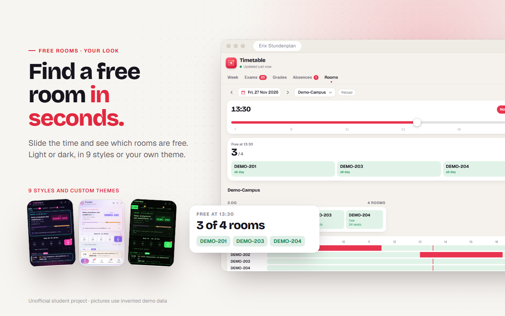

<a href="https://stundenplan.severinwehrle.dev">
  <picture>
    <source media="(prefers-color-scheme: dark)" srcset="docs/readme-banner-dark.png">
    
  </picture>
</a>

<p align="center">
  <a href="https://stundenplan.severinwehrle.dev"><b>Website</b></a> &nbsp;·&nbsp;
  <a href="https://stundenplan.severinwehrle.dev/#download"><b>Download</b></a> &nbsp;·&nbsp;
  <a href="https://stundenplan.severinwehrle.dev/#docs"><b>Docs</b></a> &nbsp;·&nbsp;
  <a href="CHANGELOG.md"><b>Changelog</b></a>
</p>

<p align="center">
  <a href="../../releases/latest"></a>
  <a href="https://chromewebstore.google.com/detail/wiss-stundenplan/ljhofcahlfajoepidneficpnjckmcomc"></a>
  <a href="../../releases"></a>
  <a href="LICENSE"></a>
</p>

**WISS Stundenplan** is a fast, private way to check your WISS timetable, exams, grades, absences and free rooms. It shows your last data the moment you open it and updates in the background, so you never wait for the extranet again.

> [!NOTE]
> **Unofficial student project**, not made by, endorsed by or affiliated with WISS or Tocco. It signs in with your own WISS account, the same way the extranet website does, and never types or stores your password.

## Get it

<p align="center">
  <a href="https://chromewebstore.google.com/detail/wiss-stundenplan/ljhofcahlfajoepidneficpnjckmcomc"></a>
  <a href="https://stundenplan.severinwehrle.dev/#download/firefox"></a>
  <a href="https://stundenplan.severinwehrle.dev/#download/android"></a>
  <a href="https://stundenplan.severinwehrle.dev/#download/iphone"></a>
  <br>
  <a href="https://stundenplan.severinwehrle.dev/#download/windows"></a>
  <a href="https://stundenplan.severinwehrle.dev/#download/macos"></a>
  <a href="https://stundenplan.severinwehrle.dev/#download/linux"></a>
</p>

All downloads with step-by-step guides are on **[stundenplan.severinwehrle.dev](https://stundenplan.severinwehrle.dev/#download)**. Linux in one line, with automatic updates afterwards:

```sh
wget -qO- https://stundenplan.severinwehrle.dev/linux.sh | sh
```

## What it does

<table>
  <tr>
    <td width="50%"><picture><source media="(prefers-color-scheme: dark)" srcset="docs/readme/2-exams-dark.png"></picture></td>
    <td width="50%"><picture><source media="(prefers-color-scheme: dark)" srcset="docs/readme/3-grades-dark.png"></picture></td>
  </tr>
  <tr>
    <td width="50%"><picture><source media="(prefers-color-scheme: dark)" srcset="docs/readme/4-absences-dark.png"></picture></td>
    <td width="50%"><picture><source media="(prefers-color-scheme: dark)" srcset="docs/readme/5-rooms-dark.png"></picture></td>
  </tr>
</table>

| Feature | What you get |
|---|---|
| **Week** | current and next lesson, room, holidays and school breaks |
| **Exams** | ZP, LB and projects with a countdown, estimated where the extranet lists nothing |
| **Grades** | average over the year, history chart and a calculator for what you still need |
| **Absences** | open excuses with their 7-day deadline, attendance per module |
| **Rooms** | free rooms at any time, with floor plans for WISS Zürich |
| **Reminders** | lessons, absence deadlines and new grades (Android and desktop) |
| **Your look** | German or English, nine styles, light and dark, your own accent colour, or your own theme as a single CSS file ([examples](themes/)) |
| **Desktop extras** | tray icon with the next lesson, a small always-on-top window, start with the computer |

*All pictures use invented demo data. Try it yourself: choose "Try demo account" on first start, no WISS login needed.*

## Privacy

- Your school data is loaded with your own login and **stays on your device**. There is no server in between.
- The app only talks to wiss.tocco.ch (your data), modulbaukasten.ch (module descriptions) and GitHub (updates).
- No ads, no tracking, no account.
- **Optional sync** between your devices transfers notes, exam corrections and some settings, end-to-end encrypted. It is off until you turn it on, and your timetable, grades, absences and login never leave your device. Keep the recovery code safe: without it and without a linked device, synced data can't be recovered.

Full details: [privacy policy](PRIVACY.md) and [terms of use](TERMS.md), also on the [website](https://stundenplan.severinwehrle.dev/#datenschutz) in German.

## Updates

Every version updates itself: Chrome and Firefox in the background, Android, Windows, macOS and the Linux AppImage with an "Install" button in the app, Linux `.rpm`/`.deb` (installed with the command above) with your normal system updates, and iPhone through the Userscripts app.

## Building it yourself

The code is open source under the MIT license. How to build, test and release it is in **[DEVELOPMENT.md](DEVELOPMENT.md)**.

## Credits
- Made by [Severin Wehrle](https://severinwehrle.dev). Co-developer [Danylo Kovalenko](https://danylokv.dev) works on the iPhone version.
- Module descriptions and the list of apprenticeships come from [modulbaukasten.ch](https://www.modulbaukasten.ch) (ICT-Berufsbildung Schweiz). A copy is included so the app also works offline. All rights to that text stay with them.
- Fonts: [Bricolage Grotesque](https://github.com/ateliertriay/bricolage), [Geist](https://github.com/vercel/geist-font), [Doto](https://github.com/oliverlalan/Doto) and Space Mono, all under the SIL Open Font License (see `chrome addon/fonts/LICENSE-fonts.txt`).
- The "Nothing" and "GitHub" styles are only inspired by those designs. No logos or brand assets are used.

## License
[MIT](LICENSE) for the code in this repository. This doesn't cover the third-party content listed under Credits.

---

<p align="center">Made by <a href="https://severinwehrle.dev"><b>Severin Wehrle</b></a> · iPhone version by <a href="https://danylokv.dev"><b>Danylo Kovalenko</b></a></p>
